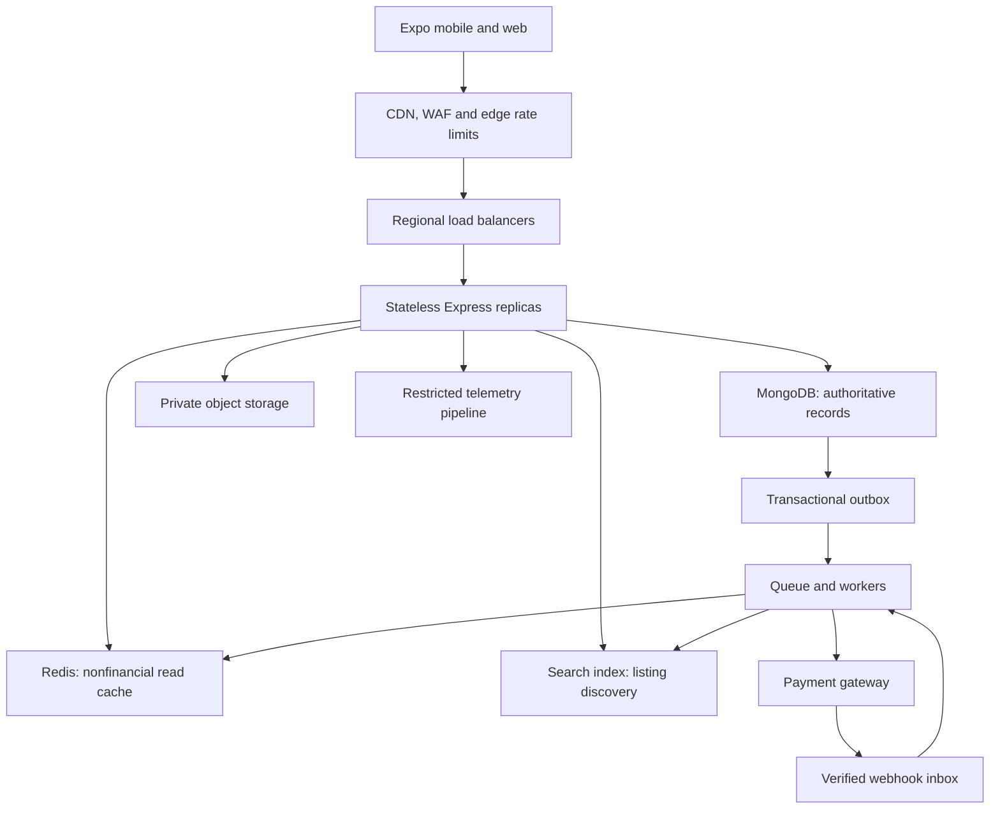

# MalikSe scalability architecture

Status: proposed architecture, not implemented or capacity-certified.
Implementation update: the current backend now includes a MongoDB-backed
submission queue with leases/retries, shared round-robin assignment, three
secondary search indexes, bounded page-based search and a 15-second candidate-ID
cache. See README for the implemented behavior and tests. The Redis/outbox,
cursor-pagination, distributed search and capacity architecture below remains
proposed; these initial features do not establish the target capacity.
Target: 10,000,000 simultaneous active users. Preserve Expo, Express,
TypeScript, Mongoose, MongoDB, and the existing app/server directory structure.

## 1. Define the workload before buying infrastructure

Concurrency alone does not determine capacity. Illustrative scenarios:

| API activity per active user | Total API requests/second |
| --- | ---: |
| One request per minute | 166,667 |
| One request per 10 seconds | 1,000,000 |
| One request per second | 10,000,000 |

Use one request per 10 seconds and a 95% read / 5% write split as a sizing
hypothesis, not measured traffic: 950,000 reads/sec and 50,000 writes/sec.
At 20 KB per response, one million responses/sec is approximately 20 GB/sec
before protocol overhead, media, retries, and replication. Measure actual
request mix, payloads, session duration, geographic distribution, and hot keys.
Payment traffic must be estimated separately from other writes.

Suggested initial service objectives, subject to agreement and measurement:
browse API p95 <200 ms, p99 <500 ms; authoritative quote API p99 <500 ms
within its home region; API availability 99.95%. Measure user-visible rendering
and network time separately. Gateway confirmation latency is a separate metric.
Zero lag everywhere is not a defensible guarantee, particularly during failures.

## 2. Findings in the existing repository

| Location | Finding | Required change |
| --- | --- | --- |
| server/src/routes/property.routes.ts | Search returns all matches, sorts by creation time, and uses case-insensitive regex | Bounded cursor pagination, smaller projections, indexed filters and a search index |
| server/src/models/Property.model.ts | Current indexes do not cover all publication/filter/sort access patterns | Design compound/partial indexes from query plans; deploy indexes through migrations |
| server/src/routes/deal.routes.ts | No gateway integration; admin can set payment-related statuses; updates use read then save | Enforced state machine, conditional writes, verified payment processing |
| server/src/models/Deal.model.ts | Monetary values are ordinary numbers; payment reference has no uniqueness constraint | Integer minor units, currency, explicit rounding, unique provider references |
| server/src/services/propertyWorkflow.ts | Existing transitions check version and status | Preserve this useful concurrency pattern and extend it to quotes/deals |
| server/src/services/propertyWorkflow.ts | Reviewer assignment issues one count query per staff account | Indexed queue metrics or bounded aggregation; atomic assignment |
| server/src/routes/document.routes.ts | Documents are stored on local disk | Private shared object storage and authorized short-lived downloads |
| server/src/index.ts and route handlers | Console errors and raw error messages; no centralized structured logging | Allowlisted logging, generic client errors and restricted audit storage |
| app/src/services/propertyService.ts | Search expects an unpaginated array | Coordinate API pagination with client infinite scrolling |

Published listings currently cannot be directly edited. A future price update
endpoint must preserve verification rules and explicitly define who can change
the price. Do not introduce a path that bypasses publication approval.

## 3. Deployment architecture



Start with a modular backend, deployed as multiple stateless processes; separate
API and worker deployments from the same repository. Do not rewrite everything
as microservices. Extract pricing/payment deployment boundaries only when load,
failure isolation, or ownership warrants it.

Use multiple availability zones, bounded database connection pools, deadlines,
backpressure, graceful shutdown, readiness probes, and autoscaling based on
latency, CPU, event-loop delay and queue age. Cap aggregate database connections
across replicas. Reject excess traffic predictably rather than exhausting memory.

At the full target, partition traffic and data into independently scalable cells.
Each property has a home partition for authoritative price and reservation
operations. Choose partition/shard keys from measured distribution and query
patterns; region alone can create hot partitions. Keep related transaction data
co-located where possible. Replicas alone do not distribute primary writes.
One exceptionally popular property remains a serialization hotspot regardless
of shard count. Protect it with admission control and bounded queues.

Use regional browsing capacity and CDN media delivery. Route financial writes
to their authority. Cross-region strong consistency costs latency; failover must
fence the previous writer and preserve acknowledged financial state.

## 4. Read-heavy browsing

- Return small listing summaries, with a default page of 20 and a hard maximum
  of 100. Use stable `(createdAt, _id)` cursors rather than deep offsets.
- Use Mongoose lean reads where document behavior is unnecessary. Fetch detail
  fields only on the detail screen. Virtualize app lists and cancel obsolete searches.
- Replace free-text regex scans with a dedicated search index. Retain indexed
  exact filters for district/type/status. Validate query types, lengths and ranges.
- Cache public, nonfinancial listing metadata and media. Include filter, cursor,
  locale and schema version in cache keys. Never put private workspaces or
  ownership documents into public caches.
- Use event-driven invalidation plus TTLs, jitter and request coalescing. Treat
  Redis/search as rebuildable projections, never the source of payment truth.
- Recheck authoritative publication/access state before sensitive actions.

Search indexes are eventually consistent. If price filtering and ordering must
also be strictly current, they need an authoritative query path; rehydrating
cached search hits cannot repair omitted results or stale ordering. This stricter
requirement must be explicitly included in capacity tests.

## 5. Price consistency contract

Interpret instant consistency as: an authoritative read started after an
acknowledged price update sees that update or a later one. This does not mean
every already-open screen changes at exactly the same physical instant.

Maintain amount in integer minor units, currency, monotonically increasing
priceVersion and updatedAt. Enforce safe-integer bounds or use a lossless numeric
representation, and define rounding for commission/tax. Migrate existing data
with reconciliation rather than silently multiplying legacy floats.

For strict single-property reads, use primary reads with linearizable read concern
and majority-acknowledged writes, with bounded timeouts. Ordinary primary or
majority reads alone are not the same real-time guarantee. These single-document
read settings are not a substitute for transaction concurrency control.
[MongoDB consistency documentation](https://www.mongodb.com/docs/manual/core/read-isolation-consistency-recency/).

Do not serve authoritative prices from Redis, CDN, secondary replicas or a search
index. Separate cacheable metadata from uncached price responses. Browsing cards
that promise current prices must obtain authoritative price observations, which
adds substantial load; a page is not automatically a globally atomic snapshot.
SSE/WebSocket version notifications can refresh screens, but are only a UX aid.
Subscribe to relevant properties; do not broadcast every change to all users.

At checkout, issue a server-owned quote containing property/deal ID, amount,
currency, priceVersion and expiry. In a transaction, conditionally update/reserve
the authoritative property/version and create the immutable quote/payment intent.
A snapshot read without a conflicting conditional write is insufficient to reject
a racing price update. Reject stale versions with a conflict requiring fresh consent.

For negotiated deals, distinguish asking price from the accepted offer: the
accepted amount is the contractual quote basis. Choose and document whether a
valid quote is honored until expiry or invalidated by repricing. Default proposal:
honor the short-lived reserved quote. Never silently charge a revised amount.
When authority is unavailable, fail the quote operation rather than inventing a
price from a stale cache.

## 6. Payment atomicity and retry safety

MongoDB can atomically commit related database records using transactions on a
replica set or sharded cluster. A standalone development database is insufficient.
Use snapshot transaction reads, majority commit writes, explicit conditional
state/version updates, unique constraints and bounded transaction retries.
[MongoDB transactions](https://www.mongodb.com/docs/manual/core/transactions/).

An external gateway and MongoDB cannot participate in one ordinary MongoDB
transaction. Use this recoverable sequence:

1. Authenticate and authorize the buyer. Require an idempotency key scoped to the
   buyer and operation; persist a canonical request hash. Reuse returns the same
   result; reuse with different input is rejected.
2. In one transaction validate/reserve the deal, persist its immutable financial
   snapshot, create a pending payment and create an outbox command. Enforce one
   active reservation if the property can only be sold once.
3. A worker calls the gateway outside the transaction with a stable provider
   idempotency key. A timeout means unknown, not failed: query/reconcile before
   attempting another charge. Check the selected provider's key retention window.
4. Verify gateway webhook signatures against the raw body, enforce replay rules,
   and durably persist an inbox entry before acknowledging. Deduplicate provider
   event IDs and payment IDs; tolerate delayed and out-of-order delivery.
5. In one database transaction apply a valid conditional payment transition,
   write balanced ledger entries, update the deal/reservation, and append audit
   and outbox records. Verify provider account, amount, currency and intent identity.
6. Retry notification/index workers independently. Reconcile pending payments
   against provider records; use compensating refunds for irreconcilable completed
   charges. Handle late success after reservation expiry explicitly.

Gateway delivery is not exactly once; local effects must be idempotent. Never
mark paid from a client redirect, an admin status patch, or a queued request alone.
Transaction callbacks may retry, so never place gateway calls inside them.
[Provider idempotency example](https://docs.stripe.com/api/idempotent_requests),
[webhook verification and delivery behavior](https://docs.stripe.com/webhooks).
These references illustrate the pattern; no gateway has been selected.

## 7. Secure logs and audit history

Use structured JSON events with server-generated request IDs, timestamp, route
template, response status, duration and allowlisted error codes. Avoid raw error
objects, bodies, authorization headers, cookies, passwords, tokens, payment data,
KYC documents and sensitive identifiers. In particular, existing document links
contain tokens in query strings: strip queries at proxies and application loggers.
Bound and sanitize untrusted text to prevent log injection.

Ship through TLS to encrypted centralized storage with least-privilege roles,
retention policies and audited access. Restrict deletion and use immutable storage
for audit exports. Application append-only conventions alone are not tamper-proof.
Persist essential financial/security audit events transactionally with business
changes; ordinary diagnostic logging should use bounded asynchronous buffering.
Alert on dropped logs and audit export lag. Sample routine request telemetry,
but retain essential financial audit events.
[OWASP logging guidance](https://cheatsheetseries.owasp.org/cheatsheets/Logging_Cheat_Sheet.html).

## 8. Preserve the base structure

Keep current routes, models and services; add focused modules incrementally:

```text
server/src/
  routes/        existing endpoints; quote/payment/webhook endpoints
  models/        existing models; Quote, Payment, Ledger, Inbox, Outbox, Audit
  services/      pricing, payment orchestration, cache, search, storage
  middleware/    request context, validation, safe errors, rate limiting
  workers/       outbox dispatch, payment reconciliation, indexing, notifications
  infrastructure/ database, queue, logger, gateway adapter
app/src/
  services/      paginated search and version-aware quote/payment clients
  store/         bounded cached metadata; explicit quote expiry/status
```

## 9. Delivery order and acceptance gates

1. Baseline: characterize representative traffic and query plans; instrument
   latency/error/pool metrics; define SLOs. Implement pagination with client
   support, input bounds, index migrations, secure errors/logging, production
   secret validation and restricted CORS. Remove arbitrary paid-status transitions.
2. Correctness: money migration, versioned prices/quotes, transaction-backed
   reservations, idempotency, ledger, inbox/outbox and gateway reconciliation.
   Test two buyers racing, concurrent price changes, key reuse, duplicate and
   reordered webhooks, crash after charge, database failover and late success.
3. Horizontal operation: stateless API replicas, private object storage, workers,
   cache and search projections, load balancing, bounded pools and backpressure.
4. Capacity expansion: use load generators distributed across enough machines
   to reach the actual request and connection target. Ramp through 10k, 100k,
   1m and 10m concurrent users with realistic think time and traffic mixes.
   Measure cache misses, hot properties, cold starts, reconnect storms, queue lag,
   memory, network and database saturation. Run sustained soak and failure tests.
5. Partition only from evidence. Verify recovery and restore drills, financial
   reconciliation, operational runbooks and cost before production rollout.

No server count or budget is credible before benchmark throughput is measured.
Estimate replica count as peak origin RPS / measured sustainable per-replica RPS,
then add measured failure and utilization headroom. Cache-hit assumptions must
exclude authoritative prices, financial operations and private reads. No load
test or production deployment was performed for this architecture document.

## 10. Concrete rollout for the existing Node.js application

This is the preferred implementation direction for the existing stack. The
fresh-stack Go/Spanner discussion is an alternative, not a migration requirement.

### A. Index and bound the current access patterns first

Introduce a paginated search contract: `{ items, nextCursor }`, default 20 and
maximum 100. Update Expo consumers in the same release; never silently limit
the existing array response and leave clients unable to access the next page.
Use a cursor tied to normalized filters, with `(createdAt, _id)` ordering.
Do not calculate an exact total count on every public search request.

Candidate Property indexes to evaluate with execution statistics:

- Published feed: `(createdAt DESC, _id DESC)`, partial on the complete publication
  predicate already used by the routes.
- Published type feed: `(type ASC, createdAt DESC, _id DESC)`, same partial predicate.
- Owner listings: `(ownerId ASC, createdAt DESC, _id DESC)`.
- Advisor queue: `(assignedAdvisorId ASC, status ASC, createdAt ASC, _id ASC)`.
- Verifier queue: `(assignedVerifierId ASC, status ASC, createdAt ASC, _id ASC)`.

These are candidates, not an instruction to create every index blindly. The
current assigned-task query sorts by updatedAt and does not filter status, so
either revise that endpoint's contract or benchmark a matching index separately.
Price range and newest-first ordering compete for index layout; benchmark both
selective and broad ranges. Ordinary compound indexes will not solve arbitrary
case-insensitive substring search. Use MongoDB Search or a separate search engine
for discovery, retaining authoritative checks for price/publication as required.

Use named, additive index migrations and disable automatic production index
creation. Capture before/after keys examined, documents examined, latency, sort
spills and write overhead. Do not drop existing indexes until usage is measured.

### B. Add two separate Redis deployments with different purposes

**Cache Redis:** evictable data, bounded memory, short timeouts, configurable TTL
and jitter. Start with rebuildable aggregates or explicitly stale public metadata.
Keep sensitive workspace/document responses out. A cache failure may fall back
to MongoDB only within a bounded origin concurrency budget; otherwise return an
overload response. Prevent simultaneous cache misses from flooding the database.

**Queue Redis:** durable operational configuration, no key eviction, restricted
network access, persistence and monitored replication. Do not let cache eviction
or cache memory pressure destroy queued work. Validate the chosen Redis/BullMQ
versions and supported topology before enabling Redis Cluster.

Use cache-aside reads and post-commit invalidation, but acknowledge the stale
refill race: a concurrent reader may write an older value after deletion. Versioned
entries and monotonic updates help; asynchronous invalidation is still not a
strong-price consistency mechanism. Cache only data whose staleness is accepted.
[Redis cache-aside documentation](https://redis.io/docs/latest/develop/use-cases/cache-aside/).

### C. Add BullMQ workers for actual background tasks

Use separate queues and worker concurrency limits for:

| Queue | Work | Ordering / correctness |
| --- | --- | --- |
| listing-projection | Update discovery records after publication or edits | Ignore events older than stored entity version; preserve unpublish tombstones |
| notifications | Future email/SMS/push integrations | Stable event/channel key; provider deduplication where supported |
| media-processing | Future thumbnail generation and document scanning | Output keyed by object version; quarantine until processing succeeds |
| payment-reconciliation | Future gateway status checks and recovery | Durable payment identity and state machine; no blind charge retries |

Do not invent notification or payment integrations merely to populate a queue.
The first worker should implement a real enabled feature. Keep user-visible
authorization, quote validation and reservation decisions on the transactional
path; enqueue their follow-up effects after the decision is durably committed.

Persist the business mutation and outbox event in one MongoDB transaction.
A dispatcher leases pending outbox entries, publishes with a stable event ID,
and marks them dispatched. A crash can publish twice; workers must tolerate this.
Keep replayable outbox history long enough to recover from broker loss, and
track completion or reconcile the target projection. A dispatched flag alone
does not prove a worker completed the job.

Use exponential backoff with jitter, maximum attempts, bounded concurrency,
failed-job retention, restricted replay tooling, alerts on oldest-job age and a
poison-message policy. Store IDs/version references rather than sensitive document
bodies in job payloads. Custom job IDs are an optimization, not the sole durable
duplicate-prevention mechanism, particularly after completed jobs are removed.
[BullMQ idempotency](https://docs.bullmq.io/patterns/idempotent-jobs),
[BullMQ retries](https://docs.bullmq.io/guide/retrying-failing-jobs).

### D. Partition by workload before physically sharding MongoDB

Partitioning means dividing work or data; sharding is distributing database
partitions across machines. They are related techniques, not two independent
features that automatically multiply throughput.

First separate API replicas, workers, media delivery, search and telemetry.
Partition worker streams by stable entity identity when per-entity ordering is
needed. Move growing verification history into an append-only event collection
when its size warrants it, with a transaction preserving current state and history.
Archive old operational events by retention policy; never TTL-delete financial
records as a generic performance optimization.

Only then introduce MongoDB sharding when working-set size, write throughput or
measured resource saturation requires it. Each shard still needs replication.
Candidate property shard key: hashed property identity for distributed point
traffic. That improves distribution but owner, location and marketplace queries
without the shard key may scatter across shards; search/read projections must
absorb the corresponding discovery workload. A hashed key is not an index for
price ranges, and one hot property is not split by hashing.
[MongoDB hashed sharding](https://www.mongodb.com/docs/manual/core/hashed-sharding/).

Review each collection independently. Deals/payments may benefit from routing by
property identity, but using that field in multiple collections does not by itself
guarantee physical co-location. Verify placement and transaction costs. Global
unique provider references and idempotency constraints need special attention:
MongoDB sharded uniqueness rules must be reconciled with the shard key before
migration. Retain a dedicated unsharded uniqueness registry initially if needed,
and account for its transaction/throughput cost. Do not select a timestamp-only,
status-only or geography-only shard key without distribution evidence.

### E. Release gates

| Phase | Required proof before progression |
| --- | --- |
| Pagination/indexing | Correct cursor traversal under equal timestamps; no query injection; bounded response; representative explain plans |
| Cache | No private/authoritative financial data cached; miss-storm limits; outage behavior; expiry/invalidation tests |
| Workers | Duplicate/reordered delivery, crash recovery and failed-job replay preserve correctness |
| Horizontal APIs | Shared private file storage, graceful termination, pool budgets and readiness work across replicas |
| Payments | Concurrent checkout, stale price, duplicated webhook and uncertain gateway outcome tests pass |
| Sharding | Targeted vs scatter-gather traffic measured; uniqueness constraints preserved; staged migration and rollback rehearsed |
| Target scale | Distributed load/soak/failover tests meet agreed latency, correctness and cost objectives |

Infrastructure configuration and package installation alone do not satisfy these
gates. Until each stage is implemented and tested, it remains proposed work.
