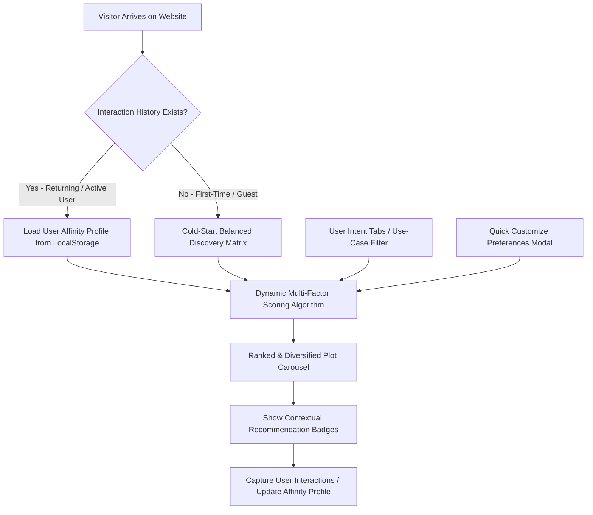

# MalikSe Dynamic Plot Recommendation Engine — Wall Plan

## 1. Problem Statement & Objective
- **Current Limitation**: When visitors open the MalikSe homepage, everyone sees the exact same 4 "Featured Verified Listings" in static chronological order (`createdAt: -1`). There is no differentiation between:
  - An investor looking for high-growth highway / airport plots.
  - A family searching for a quiet residential plot to build a home.
  - A commercial business owner searching for high-footfall shop / warehouse land.
  - A budget buyer looking for plots under ₹50 Lakh.
- **Objective**: Implement a smart, dynamic recommendation engine on the website that customizes the featured plot carousel for different users and different use-cases in real time.

---

## 2. Core Architecture

---

## 3. The 5 Core Use-Case Personas & Filter Pills

We add an interactive Recommendation Category Pill Bar directly above the carousel:

| Icon | Persona / Use-Case | Target Plots & Logic |
| :--- | :--- | :--- |
| ✨ | **Recommended For You** | Scored using client-side behavioral affinity (viewed districts, budget affinity, searched tags) + diversity rotation. |
| 🏡 | **Residential & Home Plots** | Plots tagged with `residential`, `gated`, `villa`, `house`, peaceful colonies (Danapur, Kanhauli, Patna Sadar). |
| 🏢 | **Commercial & Highway** | High-footfall NH-28, NH-57, Paswan Chowk, corner plots, industrial & retail plots. |
| 🚀 | **High-ROI Growth Corridors** | Emerging infrastructure hubs (Bihta Airport, Bodh Gaya Tourism Corridor, Darbhanga Airport, Kanhauli AIIMS Ring Road). |
| 💰 | **Under ₹50 Lakh** | Accessible, budget-friendly verified plots for first-time buyers. |

---

## 4. Multi-Factor Scoring & Ranking Engine

Each property in the catalog is assigned a real-time dynamic score based on:

$$\text{Total Score} = S_{\text{Location}} + S_{\text{Intent}} + S_{\text{Budget}} + S_{\text{Verification}} + S_{\text{Diversity}}$$

1. **Location Match ($S_{\text{Location}}$, up to 35 pts)**:
   - High score boost if property is located in districts previously explored or searched by the visitor (e.g., Patna, Vaishali, Gaya).
2. **Intent & Purpose Match ($S_{\text{Intent}}$, up to 30 pts)**:
   - Keyword relevance in title and description (`commercial`, `residential`, `industrial`, `highway`, `investment`).
3. **Budget Affinity ($S_{\text{Budget}}$, up to 20 pts)**:
   - Closeness to the user's historical price engagement range.
4. **Trust & Verification ($S_{\text{Verification}}$, 10 pts)**:
   - Verified titles, complete 30-year search clearance, GPS demarcation.
5. **Anti-Fatigue Diversity Shuffle ($S_{\text{Diversity}}$, up to 10 pts)**:
   - Dynamic session-based rotation to ensure returning users discover fresh plots on each visit rather than seeing a repetitive list.

---

## 5. UI/UX Enhancements for the Website Carousel

1. **Category Pill Bar**: Seamless horizontal switcher to jump between recommendation use-cases with instant animation.
2. **Dynamic Recommendation Badges**:
   - `✨ 96% Match for You`
   - `🏢 High Commercial Footfall`
   - `✈️ Airport Growth Corridor`
   - `🏡 Gated Residential Plot`
   - `📈 High Appreciation Potential`
   - `💰 High Value Deal`
3. **"Customize Feed" Quick Drawer / Modal**:
   - Allows users to select their goal (*Build House*, *Commercial Investment*, *Store Wealth*), target district, and budget in 2 taps.
   - Instantly recalculates and renders tailored recommendations without page reloads.
